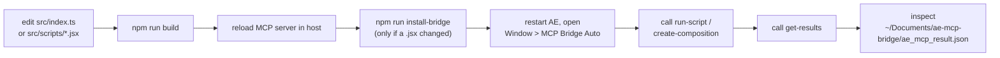

# Testing Patterns

**Analysis Date:** 2026-10-30

## Test Framework

**Runner:** None. There is no test framework in this repository.

`package.json` contains exactly four scripts, and none of them is a test:

```json
"scripts": {
  "build": "esbuild src/index.ts --bundle --platform=node --format=esm --outfile=build/index.js --packages=external && copyfiles -u 1 \"src/scripts/**/*\" build",
  "start": "node build/index.js",
  "install-bridge": "node install-bridge.js",
  "postinstall": "npm run build"
}
```

**Assertion Library:** None.

**Additional tooling that does not exist** (verified by searching the repository root for each pattern):

| Expected file | Present |
|---------------|---------|
| `jest.config.*`, `vitest.config.*`, `karma.conf.*` | No |
| `*.test.ts`, `*.test.js`, `*.spec.ts`, `*.spec.js` | No |
| `tests/`, `test/`, `__tests__/` | No |
| `.eslintrc*`, `eslint.config.*`, `biome.json` | No |
| `.prettierrc*`, `.editorconfig` | No |
| `.github/workflows/*` | No |
| `.vscode/launch.json` (debug config) | No |

The dev dependencies confirm the gap — `@types/node`, `copyfiles`, `esbuild`, `typescript`. Nothing else.

**Run Commands — what actually exists today:**

```bash
npm run build          # esbuild bundle + copy scripts; the only automated gate
npm start              # node build/index.js (stdio MCP server)
npm run install-bridge # copy build/scripts/mcp-bridge-auto.jsx into AE's ScriptUI Panels
```

## The Real Verification Loop Today

There is no automated test. A change is verified by building it and driving a live After Effects instance. The full loop:



**What "verified" means concretely** — read the result file, do not trust the acknowledgement. `run-script` only proves the command was queued; the payload `Please ensure the "MCP Bridge Auto" panel is open in After Effects.` is returned whether or not AE ever reads the file. Proof is a fresh result file whose `_responseTimestamp` post-dates the call and whose `_commandExecuted` equals the command name:

```json
{
  "status": "success",
  "message": "Composition created successfully",
  "_responseTimestamp": "2026-10-30T14:22:07.114Z",
  "_commandExecuted": "createComposition"
}
```

Failure modes that the loop must distinguish, because they look identical from the MCP side:
- Bridge files are at `~/Documents/ae-mcp-bridge/` — `ae_command.json` (server → AE) and `ae_mcp_result.json` (AE → server). If the panel is closed, commands queue forever and `get-results` returns the `"waiting"` placeholder written by `clearResultsFile()`.
- A result file older than 30 seconds is reported by `readResultsFromTempFile()` as a warning object, not an error — treat it as "AE is not updating", not as success.
- `_commandExecuted` mismatch means you read a stale result. Re-run after the panel picks up the command.

**`.jsx` changes have no compile-time safety net.** `copyfiles` copies `src/scripts/**/*` byte-for-byte into `build/scripts/`; nothing parses them until After Effects does. A typo surfaces as a bridge-level error envelope `{ status: "error", command, message, line, fileName }` or a script that silently does nothing — never as a build failure. Some scripts (`createComposition`, `createTextLayer`, etc.) additionally have an inlined duplicate inside `src/scripts/mcp-bridge-auto.jsx`, so a change must be applied twice and each copy verified separately.

## Test File Organization

**Location:** N/A — no test files exist.

**Naming:** No convention established.

**Structure:** No test directory tree exists. When tests are introduced, the lowest-friction layout consistent with this repo's single-file source is co-location-adjacent, under a top-level `tests/` directory, because `tsconfig.json` has `"include": ["src/**/*"]` and `"rootDir": "./src"` — putting `.test.ts` files inside `src/` would make `tsc` emit them into `build/`.

## Coverage

**Requirements:** None enforced. No coverage tool, no threshold, no reporting.

**View Coverage:** Not possible today.

## Test Types

**Unit Tests:** None.
**Integration Tests:** None.
**E2E Tests:** None. Manual only, per the loop above.

## What the First Tests Should Look Like

The testable surface is the filesystem bridge, not After Effects. `src/index.ts` is almost entirely deterministic string/file logic wrapped in MCP handlers — it is testable today with a tiny refactor, no AE required.

### Blocker: the bridge directory is hard-wired

Every helper calls `getAETempDir()`, which resolves `~/Documents/ae-mcp-bridge` from `os.homedir()` and `mkdirSync`s it. Tests cannot isolate state while that is true, and running tests would pollute the developer's real bridge directory — interfering with a live AE session.

**Prerequisite refactor:** extract the four bridge helpers into `src/bridge.ts` with the directory injected:

```ts
// src/bridge.ts (proposed)
export function writeCommandFile(dir: string, command: string, args: Record<string, any> = {}): void { /* ... */ }
export function clearResultsFile(dir: string): void { /* ... */ }
export function readResultsFromTempFile(dir: string): string { /* ... */ }
export async function waitForBridgeResult(dir: string, expectedCommand?: string, timeoutMs = 5000, pollMs = 250): Promise<string> { /* ... */ }
```

`src/index.ts` then passes `getAETempDir()`. Behaviour is unchanged; the logic becomes testable and `src/index.ts` shrinks. This is the single highest-value change in the repository — see `.planning/codebase/CONCERNS.md` and `.planning/BACKLOG.md`.

### Recommended stack

**vitest** — ESM-native with zero configuration (the repo is `"type": "module"`; Jest would need `--experimental-vm-modules` and a transform pipeline). Add:

```json
"devDependencies": { "vitest": "^2" },
"scripts": { "test": "vitest run", "test:watch": "vitest" }
```

`vitest` handles TypeScript directly, so no second build step is needed. Use `vi.useFakeTimers()` for the polling tests and `fs.mkdtempSync(path.join(os.tmpdir(), "ae-mcp-"))` for isolation, with an `afterEach` that removes the temp dir.

### Test cases to write first, in priority order

**1. Command file shape** — pins the protocol contract that `src/scripts/mcp-bridge-auto.jsx` depends on:

```ts
it("writes a pending command envelope", () => {
  writeCommandFile(dir, "listCompositions", { compIndex: 1 });
  const written = JSON.parse(fs.readFileSync(path.join(dir, "ae_command.json"), "utf8"));
  expect(written.command).toBe("listCompositions");
  expect(written.args).toEqual({ compIndex: 1 });
  expect(written.status).toBe("pending");
  expect(() => new Date(written.timestamp).toISOString()).not.toThrow();
});
```

Rationale: `checkForCommands()` in `mcp-bridge-auto.jsx` executes only when `commandData.status === "pending"`. If a refactor renames that field, every tool breaks at runtime with no build error.

**2. Result-file reset** — `clearResultsFile()` must write `{ status: "waiting", ... }`; a regression here means stale results are re-read as fresh.

**3. Timeout returns data, not an exception:**

```ts
it("returns a timeout error object when no result appears", async () => {
  vi.useFakeTimers();
  const p = waitForBridgeResult(dir, "createComposition", 500, 50);
  await vi.advanceTimersByTimeAsync(600);
  const parsed = JSON.parse(await p);
  expect(parsed.error).toContain("Timed out waiting for bridge result");
  expect(parsed.error).toContain("createComposition");
});
```

**4. Stale-result discrimination** — the core of `waitForBridgeResult`: a result whose `_commandExecuted` is a *different* command must be ignored. Seed `ae_mcp_result.json` with `{ "_commandExecuted": "listCompositions" }`, wait for `"createComposition"`, assert timeout. This is the test that protects the `expectedCommand` filter, which exists purely to stop the server returning yesterday's answer.

**5. 30-second staleness warning** — write a result file, set its mtime 60 s in the past (`fs.utimesSync(file, past, past)`), assert the returned JSON has a `warning` key and preserves `originalContent`. Do not let this become a timing-sensitive test — set mtime explicitly instead of sleeping.

**6. Missing file message** — delete the result file, assert `{ error: "No results file found. Please run a script in After Effects first." }`.

**7. `run-script` whitelist rejection** — assert the `isError: true` envelope and that the message contains `is not allowed`. The `allowedScripts` array at `src/index.ts:176-196` is the only guard between the model and arbitrary script names; it deserves a test that also asserts every allowed name has a matching `case` in `executeCommand` (see #9).

**8. MCP-level registration smoke test** — this is the highest-confidence test per unit of effort, because it exercises real handler wiring without AE:

```ts
import { Client } from "@modelcontextprotocol/sdk/client/index.js";
import { InMemoryTransport } from "@modelcontextprotocol/sdk/inMemory.js";

it("registers the full tool surface", async () => {
  const [clientT, serverT] = InMemoryTransport.createLinkedPair();
  await server.connect(serverT);
  const client = new Client({ name: "test", version: "0.0.0" }, { capabilities: {} });
  await client.connect(clientT);
  const { tools } = await client.listTools();
  expect(tools.map(t => t.name)).toEqual(
    expect.arrayContaining(["run-script", "get-results", "create-composition", "apply-effect"])
  );
  const prompts = await client.listPrompts();
  expect(prompts.prompts.length).toBe(3);
  const resources = await client.listResources();
  expect(resources.resources.length).toBe(1);
});
```

Pin the exact counts (13 tools / 3 prompts / 1 resource). A tool silently disappearing from the surface is otherwise invisible until a user reports it.

**9. Bridge ↔ server contract test** — parse `src/scripts/mcp-bridge-auto.jsx` as text and assert every entry in `allowedScripts` appears as a `case "<name>":` inside `executeCommand`. Crude, but it is the only way to catch the real class of bug in this repo: a tool registered in TypeScript that the AE side does not implement, producing `{ error: "Unknown command: <name>" }` at runtime. A regex over the file is enough:

```ts
const bridge = fs.readFileSync("src/scripts/mcp-bridge-auto.jsx", "utf8");
const cases = new Set([...bridge.matchAll(/case\s+"([^"]+)":/g)].map(m => m[1]));
for (const name of allowedScripts) expect(cases.has(name)).toBe(true);
```

This requires exporting `allowedScripts` from `src/index.ts` (currently a local inside the `run-script` handler) — a one-line lift to module scope.

**10. Duplicate-drift guard** — the standalone `src/scripts/*.jsx` files and their inlined copies in `mcp-bridge-auto.jsx` must stay identical. Assert that each standalone script's function body appears verbatim in the panel file. Cheap, and it converts a silent divergence into a red test.

### What cannot be unit tested

The ExtendScript internals — `app.project`, `CompItem`, `Property`, keyframes, `app.scheduleTask` — only exist inside After Effects. There is no ES3 runtime to load them into. Do not attempt to mock the entire AE DOM; the payoff is negative. Instead:

- **Golden fixtures.** Capture real `ae_mcp_result.json` payloads from a session into `tests/fixtures/` and assert the TypeScript side parses/handles them correctly. This locks the wire format without AE.
- **Manual AE checklist** for the `.jsx` side: after any `.jsx` change, run `npm run build`, `npm run install-bridge`, restart AE, open the panel, invoke the affected command, and confirm a fresh `_responseTimestamp` plus plausible payload. Record it in the PR/commit description.

## Mocking

**Framework:** None installed. With vitest, use `vi.mock` / `vi.spyOn`.

**What to mock:**
- `os.homedir()` — only if the `dir` injection refactor above is not done first. Injection is strongly preferred; mocking a Node builtin to redirect a filesystem path is a smell.
- `fs` read failures inside `waitForBridgeResult`, to cover the `// transient read error; continue polling` branch.
- Timers, for every polling test.

**What NOT to mock:**
- The filesystem. Real `fs` against a `mkdtempSync` directory is faster to write and catches encoding/JSON-shape bugs that a mock hides. `mcp-bridge-auto.jsx` writes UTF-8 with `resultFile.encoding = "UTF-8"`, so round-trip through real files is meaningful.
- The MCP SDK. Use `InMemoryTransport` rather than stubbing `server.tool`.

## Fixtures and Factories

**Test Data:** None exist. Fixtures should be captured verbatim from a real session rather than hand-authored — the whole point is to lock the shape the AE side actually produces.

**Location (proposed):** `tests/fixtures/ae_mcp_result.<command>.json`, one file per command, plus `tests/fixtures/ae_command.json`.

## Common Patterns (to establish)

**Async polling with fake timers:** never `await sleep()` in a test for `waitForBridgeResult` — it takes 5 s by default. Use `vi.useFakeTimers()` and pass a short `timeoutMs`, or advance timers explicitly.

**Asserting on `isError` envelopes:** assert both the flag and a substring of the message; the text is the only diagnostic the model receives.

**Temp-dir isolation:** `beforeEach` → `mkdtempSync`, `afterEach` → `rmSync(dir, { recursive: true, force: true })`. Never let a test touch `~/Documents/ae-mcp-bridge`.

## Coverage Gaps

**Everything.** 963 lines in `src/index.ts` and 1662 in `src/scripts/mcp-bridge-auto.jsx` are unexercised by any automated check. The highest-risk untested logic:

- `waitForBridgeResult` (`src/index.ts:78-102`) — hand-rolled polling with a `lastSize` heuristic. It returns on the *first* JSON body that parses and matches, with no verification the file write completed. A partial write that happens to be valid JSON is accepted.
- `readResultsFromTempFile` (`src/index.ts:40-75`) — the 30-second staleness branch.
- `run-script` `allowedScripts` (`src/index.ts:176-196`) — security-relevant whitelist.
- `executeCommand`'s 19-case `switch` (`src/scripts/mcp-bridge-auto.jsx`, from ~line 1495) — the only implementation of every AE operation.
- `install-bridge.js` — path probing across AE 2021-2026 on two platforms, with `process.exit(1)` on failure.

---

*Testing analysis: 2026-10-30*
